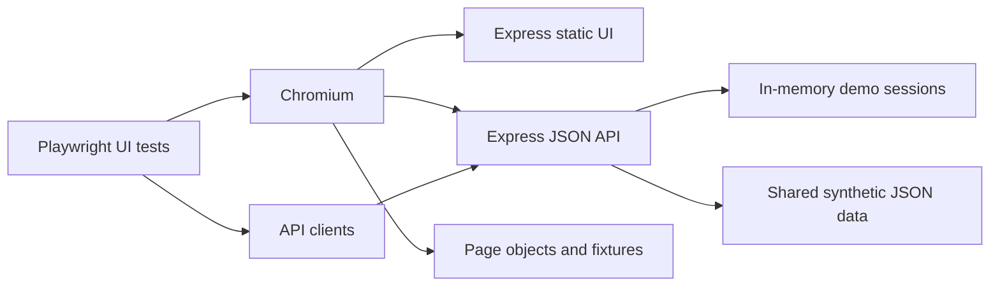

# Architecture

## Application and automation

Express serves the static browser application and JSON endpoints from one local process at `127.0.0.1:4173`. Browser code logs in through the API, stores the demo token in local storage, and attaches it as a bearer token for protected account and transaction requests. Account and transaction fixtures are shared JSON files, keeping browser output and API contracts aligned.

## Framework components

- **Page objects** encapsulate accessible locators and user-level actions for login, dashboard, and transactions.
- **Fixtures** create page objects and API clients per test. The `signedIn` fixture performs login and confirms dashboard readiness for tests that need an authenticated UI.
- **API clients** wrap auth, account, and transaction operations so tests share endpoint knowledge and bearer-header setup.
- **Types and test data** describe response contracts and load the same deterministic JSON records used by the app.
- **API/UI suites** may run independently or together. API test contexts are provided by Playwright, and UI tests use browser contexts isolated per test.

## Test execution flow

Playwright's `webServer` starts `npm start`, waits for `/api/health`, then launches Chromium. UI and API tests run independently in parallel; the HTML reporter writes to `playwright-report`. CI enables one retry and limits workers; local runs default to no retries. Failed tests retain screenshots and video, and traces are captured on the first retry.

## Authentication boundary

The API accepts only tokens created by a valid local demo login and rejects missing, unknown, and logged-out tokens on protected routes. Session state is an in-memory map. This intentionally simple model is useful for exercising authorization behavior but is not production authentication.